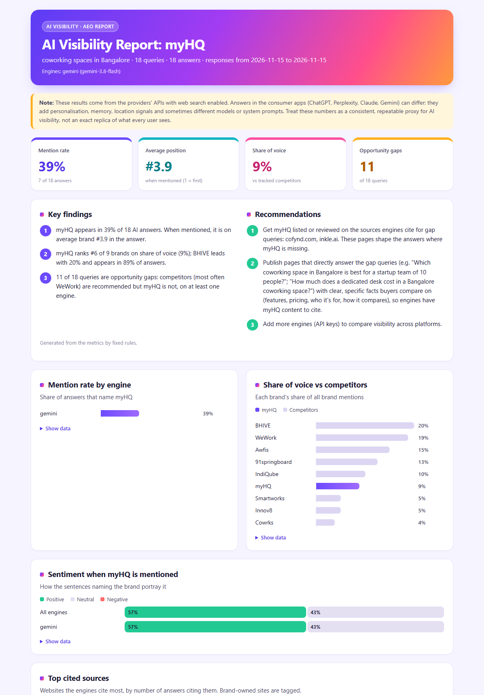

# AI Visibility Tracker

Measures how a brand shows up in AI-generated answers, the core of **Answer Engine
Optimization (AEO)**. It does three things:

1. **Asks 4 AI engines buyer questions.** Perplexity, ChatGPT (OpenAI), Claude and Gemini,
   each with web search on (e.g. "best coworking space in Bangalore for a 10-person team?").
2. **Turns the answers into marketing metrics.** Mention rate, position vs competitors, share
   of voice, sentiment, top cited sources, and **opportunity gaps**: questions where
   competitors are recommended but your brand isn't.
3. **Produces a report with spend controls.** A single HTML file with charts, 3 key findings
   and 3 recommendations. Costs are previewed before a run, answers are cached, and the actual
   cost is printed after every run.

It works for any company: each brand is one YAML config file.

## Example output

A real run for **myHQ** (coworking spaces in Bangalore): 18 buyer questions asked to Gemini with
Google Search, about $0.85 in total.



Full report: [examples/myhq_report.html](examples/myhq_report.html). Download it and open it in
a browser; GitHub shows HTML files as source code.

## Setup

Requires Python 3.11 or newer.

```bash
cd "myHQ Agent"
py -m venv .venv
.venv\Scripts\activate          # macOS/Linux: source .venv/bin/activate
pip install -r requirements.txt
copy .env.example .env          # macOS/Linux: cp .env.example .env
```

### Adding API keys

Open `.env` and paste in the keys you have:

```
PERPLEXITY_API_KEY=pplx-...     # https://www.perplexity.ai/account/api
OPENAI_API_KEY=sk-...           # https://platform.openai.com/api-keys
ANTHROPIC_API_KEY=sk-ant-...    # https://platform.claude.com/settings/keys
GEMINI_API_KEY=...              # https://aistudio.google.com/apikey
```

Engines without a key are **skipped with a warning**, so you can add keys one at a time.
`py AI_Visibility.py status` shows which keys are picked up. `.env` is git-ignored.

Sentiment scoring and `generate-queries` use **one cheap utility model**, set under
`utility_llm` in `config/settings.yaml` (default: `gemini-3.8-flash`, using the Gemini key, so
one Gemini key runs the whole tool). If its key is missing, sentiment is skipped with a warning
and everything else still works.

## Usage

```bash
# 1. Preview: how many calls and roughly what it will cost. Sends nothing.
py AI_Visibility.py run --dry-run

# 2. Try it cheaply: first 2 queries, one engine
py AI_Visibility.py run --max-queries 2 --engines perplexity

# 3. Full run. Queries that already have an answer are reused from the cache (free).
py AI_Visibility.py run

# 4. Analyse and build the HTML report (reports/output/myhq_report_<date>.html)
py AI_Visibility.py report
```

Or do it all in one command (generate questions, ask the engines, build the report):

```bash
py AI_Visibility.py full --project snabbit --generate 12 --engines gemini
```

`--generate N` is optional: leave it out to use the questions already in the config. Gemini is
asked to always search; if it still answers without searching, the tool re-asks it up to twice and
otherwise marks the question as failed (not saved), so only searched answers reach the report.

Other commands:

```bash
py AI_Visibility.py analyze                      # metrics in the terminal (+ reports/output/myhq_metrics.json)
py AI_Visibility.py generate-queries --count 18  # add realistic buyer queries to the config
py AI_Visibility.py report --no-sentiment        # zero-cost report (skips sentiment scoring)
py AI_Visibility.py status                       # keys, models, all-time spend
```

`--project myhq` is the default. Pass `--project <name>` to use another file in `config/projects/`.

### Spend controls

- **`--dry-run`** shows planned calls and estimated cost per engine before anything is sent.
- **`--max-queries N`** and **`--engines a,b`** cap how much a run can spend.
- **Caching:** if an answer already exists for an engine + model + question, it is reused,
  never paid for twice. Changing the model in settings counts as a new question.
- **Per-run cost table:** every run prints new calls, cached, failed, tokens and cost per engine.
  Perplexity reports exact costs. The other engines are estimated from their token and
  search counts using the prices in `config/settings.yaml` (marked `*`).

Typical cost per query (estimates in `settings.yaml`): Perplexity ~$0.005, Gemini ~$0.05,
OpenAI ~$0.05, Claude Opus ~$0.11. So 8 queries × 4 engines ≈ $1.72. Switch Claude to
`claude-sonnet-5-5` in settings to roughly halve its cost.

## Configuring a project

Each project is one YAML file in `config/projects/`. Copy `myhq.yaml` to start a new one.

| Key           | Meaning |
|---------------|---------|
| `brand`       | Your brand `name`, `aliases` (every spelling that counts as a mention) and `domains` (your websites, tagged in the cited-sources chart) |
| `category`    | What buyers are shopping for, e.g. "coworking spaces in Bangalore" or "CRM software for small businesses" |
| `competitors` | Known competitors, each with aliases and (optional) domains |
| `queries`     | The buyer questions to ask. Edit freely, or run `generate-queries` |

Aliases are matched **case-insensitively as whole words**. Avoid aliases that are ordinary
words (e.g. "We Work" would match "where we work").

`generate-queries` works for any category. It writes a mix of buyer intents (discovery,
specific needs, pricing, reviews, comparisons), never names your brand (that would inflate
mention rate), names competitors in at most 3 questions, skips duplicates, and keeps the
comments in your YAML file.

Engine models, endpoints and prices live in `config/settings.yaml`, because they change often.

## Metrics

| Metric | Meaning |
|--------|---------|
| **Mention rate** | % of answers that name your brand (any alias) |
| **Average position** | When named, your rank among all tracked brands in that answer, by order of first mention (1 = named first) |
| **Share of voice** | Your mentions ÷ mentions of all tracked brands (you + competitors) |
| **Sentiment** | Whether the sentences naming you are positive, neutral or negative (cheap model; only those sentences are sent; scored once and cached) |
| **Top cited domains** | The websites engines cite most (each answer counts a domain once). These are the sites to get featured on |
| **Opportunity gaps** | Questions where at least one engine names competitors but not you, with the sites it cited. These are the highest-priority fixes |

Analysis uses the stored answer for each (engine, question) currently in the config. Mention
detection is plain text matching (free and repeatable), so alias edits apply immediately.

The report's 3 findings and 3 recommendations come from **fixed rules** applied to these
metrics, so every sentence can be traced to a number.

## How it works

```
AI_Visibility.py            CLI (typer): run, analyze, report, generate-queries, status
config/
  settings.yaml             engine models, endpoints, prices, the utility model
  projects/myhq.yaml        brand, competitors, queries
engines/
  base.py                   Engine interface + EngineResponse/Citation shapes, retries
  perplexity.py             Perplexity Agent API + web_search tool
  openai_engine.py          OpenAI Responses API + web_search tool
  claude_engine.py          Anthropic SDK + web_search server tool
  gemini_engine.py          Gemini generateContent + Google Search grounding
core/
  config.py                 YAML → typed objects
  runner.py                 plans calls (cache check), runs them concurrently
  storage.py                SQLite: runs, responses (raw JSON), citations, sentiments
  query_generator.py        cheap-model query generation
analysis/
  mentions.py               alias matching, mention order, snippets, domain ownership
  sentiment.py              cheap-model sentiment scoring with cache
  metrics.py                per-engine + overall metrics, share of voice, domains, gaps
  pipeline.py               runs the three above in order
reports/
  summary.py                rule-based 3 findings + 3 recommendations
  html_report.py            self-contained HTML report (pure HTML/CSS, light + dark)
  output/                   generated reports (git-ignored)
data/
  myhq.db                   SQLite database (git-ignored)
tests/                      offline tests, run with `py -m pytest -q`
```

**Design choices worth knowing:**

- **One interface, many engines.** Each provider converts its own response format into the
  same `EngineResponse` (answer text, citations, tokens, cost, raw JSON). Nothing downstream
  knows which provider an answer came from.
- **Cited vs retrieved sources.** Engines often look at 10+ pages but cite only a few. Both are
  stored, with a flag for which were cited. Domain metrics use the cited ones, falling back to
  retrieved ones if an engine marks none.
- **Deterministic first.** Mention detection, all metrics and the findings/recommendations are
  plain code: free, repeatable, explainable. An LLM is used only for sentiment.
- **Failure handling.** Rate limits and server errors are retried with exponential backoff. Bad
  keys or parameters fail fast with the API's error message. A failed query isn't cached, so the
  next run retries it.

### Engines

| Engine     | API | Citations come from |
|------------|-----|---------------------|
| Perplexity | Agent API `/v1/agent`, model `perplexity/sonar`, `web_search` tool | `search_results` output item; `[web:N]` markers mark cited ones |
| OpenAI     | Responses API, `web_search` tool | `url_citation` annotations (cited) + `web_search_call.action.sources` (retrieved) |
| Claude     | Messages API via `anthropic` SDK, `web_search_20260209` tool | `web_search_result_location` citations on text blocks (cited) + `web_search_tool_result` (retrieved) |
| Gemini     | `generateContent` with `google_search` grounding | `groundingChunks`; `groundingSupports` mark cited ones. Google redirect links are resolved to real URLs |

Perplexity ended support for its older Sonar Chat Completions API (`/v1/sonar`) on
27 Sep 2026. This tool uses the replacement, the Agent API.

## Caveat

API answers can differ from what people see in the consumer apps (ChatGPT, Perplexity,
Claude, Gemini). Consumer apps add personalisation, memory, location and sometimes different
models or system prompts. Treat these results as a consistent, repeatable **proxy** for AI
visibility, not an exact replica. The report states this too.

## Not yet verified live

Request and response formats follow each provider's docs (Nov 2026) and are covered by offline
tests using documented response shapes, but no live API run has been done yet. On the first
run, check that each engine's "cited" count per answer is above 0, and that Perplexity accepts
`model: perplexity/sonar` with the `web_search` tool. Competitor `domains` in `myhq.yaml` are
best guesses; verify them.
